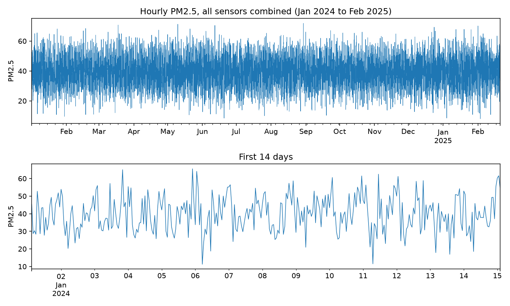

# Time Series Modeling of Air Quality in Nairobi

Hourly PM2.5 readings from a network of 10 sensors in Nairobi, stored in MongoDB and wrangled into a clean, time-indexed pandas series for time series modelling.

**Status:** Lessons 3.1 (data wrangling with MongoDB), 3.2 (linear regression in time series), and 3.3 (autoregressive models) complete.

## What this project does so far

- Loads the sensor data into a local MongoDB 7 collection (`air-quality.nairobi`) with a timestamp index.
- Explores the collection with `pymongo`: document counts, a sample document, distinct sensors and measurement types, and aggregation pipelines.
- Packages the pipeline as `wrangle_data()`, which returns PM2.5 as a timezone-aware, sorted, hourly DataFrame, optionally for a single sensor.
- Creates lag features and trains linear regression models to investigate how previous PM2.5 readings relate to the current reading.
- Evaluates models using a chronological train/test split and compares them with a persistence baseline.

## Data

`nairobi.parquet`, provided as part of the course materials. It is not committed to this repository (`data/raw/` is git-ignored).

| Property | Value |
|---|---|
| Documents | 10,000 |
| Sensors | 10 (`nairobi_001` to `nairobi_010`) |
| Measurement type | `P2` (PM2.5) only |
| Fields | `timestamp`, `sensor_id`, `value_type`, `value`, nested `location` (`lat`, `lon`) |
| Period | 2024-01-01 to about 2025-02-20 |
| Readings per sensor | 938 to 1,051 (e.g. `nairobi_001`: 953) |

## Results (Lesson 3.1)

- All 10,000 timestamps are distinct, and every one of the 9,999 gaps between consecutive readings is exactly one hour. The combined series is a perfectly regular hourly series with no missing values.
- `nairobi_001` alone has 953 readings, with mean PM2.5 of 39.8 (median 39.9, standard deviation 9.8, range 8.0 to 67.4).
- Stored timestamps are timezone-naive. `wrangle_data()` treats them as UTC and converts them to Africa/Nairobi.

## Results (Lesson 3.2)

- The modelling dataset contains 8,774 observations from 2024 after creating lag features and removing rows with missing lag values.
- Data was split chronologically: 7,019 training observations (80%) and 1,755 testing observations (20%). The test period runs from 2024-10-19 21:00 to 2024-12-31 23:00 (Africa/Nairobi).
- A single-lag linear regression model achieved MAE 7.4591, RMSE 9.2876 and R² 0.0729.
- A multiple-lag model using the previous 1, 2, 3 and 7 hours achieved MAE 7.3771, RMSE 9.1993 and R² 0.0904.
- Both regression models outperformed the persistence baseline (MAE 9.2636, RMSE 11.6418, R² -0.4567). The multiple-lag model improved only modestly over the single-lag model.
- The relatively low R² values indicate that these lag features explain only a limited amount of variation in the test data.

| Model | MAE | RMSE | R² |
|---|---:|---:|---:|
| Persistence baseline | 9.2636 | 11.6418 | -0.4567 |
| Linear regression (lag 1) | 7.4591 | 9.2876 | 0.0729 |
| Multiple-lag regression (lags 1, 2, 3, 7) | 7.3771 | 9.1993 | 0.0904 |

## Results (Lesson 3.3)

- Used ACF and PACF plots to diagnose the autoregressive order. The PACF showed no clean cutoff due to the 10-sensor patchwork, but lag 4 was the first inside the confidence band. We selected **AR(3)** and verified this via AIC/BIC (AR(3) had the lowest BIC).
- Fitted an AR(3) model using `statsmodels.AutoReg`. The coefficients decayed quickly (`lag_1`: 0.23, `lag_2`: 0.11, `lag_3`: 0.05), confirming weak short-term memory in the series.
- Walk-forward validation for the first 30 hours of the test set yielded an **MAE of 7.78**, which is **25.33% better** than the persistence baseline (MAE 10.42) on the same 30 steps.
- The model's predictions appeared "smoothed" and missed sudden spikes. This is expected **mean reversion** behavior for an AR model on noisy sensor data.
- The PACF showed a significant positive spike at **lag 24** (0.20), indicating a **daily cycle** (likely traffic or temperature inversions). A non-seasonal AR model cannot capture this, so a seasonal model should be investigated in a later lesson.

| Model | MAE (30-step walk-forward) | AIC | BIC |
|---|---:|---:|---:|
| Persistence baseline | 10.42 | — | — |
| AR(1) | 7.92 | 51461.5 | 51482.0 |
| AR(3) (chosen) | 7.78 | 51320.8 | 51355.1 |
| AR(5) | 7.82 | 51299.9 | 51347.9 |
| AR(7) | 7.76 | 51238.5 | 51300.2 |

## Limitations

- Each hourly value comes from one of the 10 sensors, at a different location, so the combined series is a patchwork of sensors rather than one instrument's record. Differences between sensors appear as noise.
- The data does not state its timezone; assuming UTC is the course's convention.
- Only PM2.5 is available in this dataset.
- The combined series switches between sensors. Lag features can therefore compare readings from different sensors, meaning sensor-to-sensor differences may affect the apparent time relationships.
- The `lag_7` feature represents seven hours earlier, not seven days, because the observations are hourly.
- The persistence baseline uses the actual previous observation for each test prediction. This is a rolling one-step-ahead evaluation, not a fixed-origin multi-step forecast.
- The models use only past PM2.5 readings as predictors. Their modest test R² values suggest that additional relevant variables or a different modelling approach may be needed.

## Reproduce

    uv sync
    docker run -d --name nairobi-mongo -p 27017:27017 -v nairobi-mongo-data:/data/db mongo:7
    # place nairobi.parquet (from the course materials) in data/raw/
    uv run python src/load_mongo_data.py
    # open notebooks/3.1_data_wrangling_mongodb.ipynb (kernel: nairobi-env)
    # then open notebooks/3.2_linear_regression_lags.ipynb
    # then open notebooks/3.3_autoregressive_models.ipynb

The MongoDB host defaults to `localhost`; set the `MONGO_HOST` environment variable to use another server. Tested with Python 3.14.2, pandas 3.1.0, pymongo 4.19.0, scikit-learn 1.9.1, statsmodels 0.15.0 and MongoDB 7.

## Notebooks

| Notebook | Topic |
|---|---|
| `notebooks/3.1_data_wrangling_mongodb.ipynb` | Connect, explore, import and wrangle PM2.5 data from MongoDB |
| `notebooks/3.2_linear_regression_lags.ipynb` | Create lag features, train linear regression models and evaluate time series predictions |
| `notebooks/3.3_autoregressive_models.ipynb` | Use ACF/PACF to select AR order, fit AR models, and run walk-forward validation |

## Layout

    data/raw/            raw parquet file (git-ignored)
    data/processed/      processed data (git-ignored)
    notebooks/           one notebook per lesson
    src/load_mongo_data.py   loads the parquet file into MongoDB
    src/mongo_wrangle.py     wrangle_data(): MongoDB to clean DataFrame
    reports/figures/     saved charts
    pyproject.toml, uv.lock  environment (uv)
