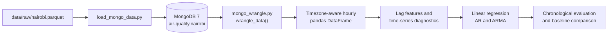

# Nairobi Air Quality Time-Series Pipeline and Modelling

A reproducible Python and MongoDB project that ingests hourly PM2.5 sensor data, creates a clean time-indexed dataset, and evaluates forecasting approaches with chronological validation.

The project uses readings from 10 sensors in Nairobi. It combines database exploration and data wrangling with lag-feature engineering, linear regression, autoregressive models, and ARMA modelling. The results are deliberately reported with their limitations: the models improve on a persistence baseline, but the low R² values show that past PM2.5 readings alone do not explain most hourly variation.

## Why this project matters

Air-quality data is time-dependent and operationally messy. A useful workflow must preserve timestamps, handle time zones, support reproducible transformations, and evaluate models in a way that does not use future observations to predict the past.

This project treats the database and data-preparation steps as first-class engineering work. The reusable `wrangle_data()` function returns a sorted, timezone-aware pandas DataFrame and can optionally select one sensor. The modelling notebooks then use chronological splits and forecasting baselines rather than random train/test sampling.

## Data and architecture

The source file, `nairobi.parquet`, is provided as course material and is not committed to the repository.



The workflow is:

1. Load the Parquet data into a local MongoDB 7 collection with a timestamp index.
2. Explore document counts, sensors, measurement types, sample documents, and aggregation results with PyMongo.
3. Use `wrangle_data()` to filter PM2.5, sort timestamps, handle timezone assumptions, and return a modelling-ready DataFrame.
4. Create lag features and inspect autocorrelation with ACF/PACF diagnostics.
5. Train models using chronological splits or walk-forward evaluation.
6. Compare the models with a persistence baseline and document what the metrics do and do not show.

## Dataset summary

| Property | Value |
|---|---|
| Documents | 10,000 |
| Sensors | 10, from `nairobi_001` to `nairobi_010` |
| Measurement | PM2.5 (`P2`) |
| Period | 2024-01-01 to approximately 2025-02-20 |
| Readings per sensor | 938–1,051 |
| Combined frequency | Hourly, with no missing gaps in the combined series |
| Modelling observations | 8,774 after lag creation |
| Split | 7,019 training and 1,755 testing observations |

The stored timestamps are timezone-naive. The project follows the course convention of treating them as UTC and converting them to `Africa/Nairobi`.

## Results

### Lag-feature regression

The multiple-lag regression model achieved the lowest MAE in the main comparison, but the improvement over a single lag was modest and the R² remained low.

| Model | MAE | RMSE | R² |
|---|---:|---:|---:|
| Persistence baseline | 9.2636 | 11.6418 | -0.4567 |
| Linear regression, lag 1 | 7.4591 | 9.2876 | 0.0729 |
| Linear regression, lags 1, 2, 3, 7 | 7.3771 | 9.1993 | 0.0904 |

### Autoregressive and ARMA models

ACF/PACF diagnostics supported short-term dependence, but the 10-sensor series behaves like a patchwork of different instruments. On the first 30 test steps, AR(3) achieved an MAE of 7.78 and improved on the persistence baseline MAE of 10.42. The full-test ARMA(2,1) forecast achieved MAE 7.80, a 15.7% improvement over its persistence baseline of 9.25, but its R² was approximately zero.

The key modelling finding is that the simplest lag-feature regression performed best on MAE. This does not mean ARMA is generally inferior; in this dataset, sensor switching introduces high-frequency noise that limits what the MA term can learn.

## What this demonstrates

This project demonstrates practical foundations for Data Engineering and Analytics Engineering roles:

- Loading operational data into MongoDB and querying it with PyMongo
- Building a reusable data-wrangling function rather than repeating notebook transformations
- Preserving time order and timezone information during preparation
- Creating lag features and validating time-series assumptions
- Using chronological train/test splits, walk-forward validation, and persistence baselines
- Comparing models with MAE, RMSE, R², AIC, and BIC
- Interpreting weak results honestly instead of hiding poor fit
- Connecting data-engineering decisions to modelling reliability

## Repository structure

```text
.
├── data/
│   ├── raw/                         # source Parquet file; not committed
│   └── processed/                   # generated data; not committed
├── notebooks/
│   ├── 3.1_data_wrangling_mongodb.ipynb
│   ├── 3.2_linear_regression_lags.ipynb
│   ├── 3.3_autoregressive_models.ipynb
│   └── 3.4_arma_models.ipynb
├── reports/
│   └── figures/                     # saved charts
├── src/
│   ├── load_mongo_data.py           # Parquet to MongoDB loader
│   └── mongo_wrangle.py             # reusable wrangle_data() function
├── pyproject.toml
├── uv.lock
└── README.md
```

## Running the project

You need Python, [uv](https://docs.astral.sh/uv/), Docker, and access to the course-provided `nairobi.parquet` file.

```bash
# Install the project environment
uv sync

# Start MongoDB 7 locally
docker run -d --name nairobi-mongo -p 27017:27017 \
  -v nairobi-mongo-data:/data/db mongo:7

# Place nairobi.parquet in data/raw/, then load it
uv run python src/load_mongo_data.py
```

Open the notebooks in order using the project environment as the Jupyter kernel:

1. `notebooks/3.1_data_wrangling_mongodb.ipynb`
2. `notebooks/3.2_linear_regression_lags.ipynb`
3. `notebooks/3.3_autoregressive_models.ipynb`
4. `notebooks/3.4_arma_models.ipynb`

The MongoDB host defaults to `localhost`. Set the `MONGO_HOST` environment variable when using another host.

## Limitations and next steps

The combined series switches between 10 sensors at different locations, so consecutive observations may come from different instruments. This creates sensor-to-sensor variation that can look like noise or false shocks. The data also does not state its timezone, so the UTC assumption is a project convention.

The models use only past PM2.5 readings. The low test R² values suggest that weather, traffic, location, seasonality, and sensor identity could add useful explanatory power. Future improvements could include sensor-specific modelling, explicit daily seasonality, richer exogenous features, automated data-quality checks, experiment tracking, and scheduled pipeline execution.
